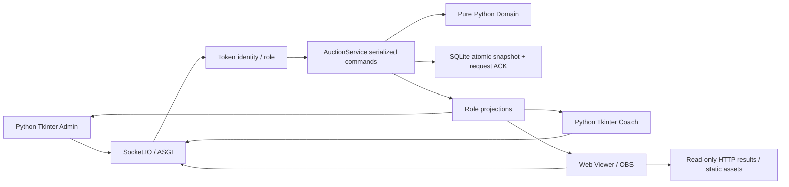

# 專題架構與方法

Client 的 Tk 主執行緒負責 UI；背景 asyncio worker 使用 Socket.IO，Queue 傳遞命令／事件，避免網路阻塞 GUI。View model 使用 Server snapshot 的 version；ACK 表示命令結果，不能當成本地競標狀態。重連重新登入並取完整 snapshot，不自动重送不確定命令。

Transport（`final_project/server/events.py`、`schemas.py`）驗證資料形狀、已認證 session 與角色。Token 由環境變數或明確指定的 demo root 提供，未配置拒絕啟動；不寫入日誌。教練只能代表自己的隊伍出價，Viewer 無修改權。

Projection 是密封競標的資料邊界：Admin 得到全部 bids，Coach 得到自己的 myBid，Viewer 僅公開狀態、倒數、隊伍、預算與已結算結果。HTTP 沒有完整內部 state API。詳見 [協定](FINAL_PROJECT_PROTOCOL.md)。

AuctionService 是唯一狀態寫入者，以 lock 序列化命令，呼叫無 I/O 的 domain transition，先原子持久化 snapshot 與 request ACK，再換入記憶體並發布。request_id 依身份隔離，重送相同命令回傳既有結果；不同內容衝突拒絕，round_id 防止舊輪指令污染新輪。SQLite 儲存全體狀態與去重資料；不得直接從 GUI 修改 DB。

執行中 deadline 以 monotonic clock 管理，持久化 UTC deadline 支援 restart；恢復時已過期即結算一次。倒數 broadcast 僅更新顯示，結算由 timer／Admin 驅動。純 domain 保留預算、5 人、zone、0 元及第二人累積花費規則；已修正缺陷另見 [baseline](FINAL_PROJECT_RULES_BASELINE.md)。

FastAPI 提供 read-only API 與限定靜態路徑，Uvicorn 單 worker 執行。Viewer 本地 vendor JS，無需 CDN；wheel 資產位於環境 prefix 的 `share/coach-auction-final-project/`，runtime 與只讀資產分離。原 Node／legacy public 保留，Python 不讀正式 `data/`。

目前為單一競標 session／8 隊，不支援多 server worker 或分散式鎖。SQLite 同步寫入、小型課堂規模適用。可維護 raw TCP adapter，但本輪不加入。
