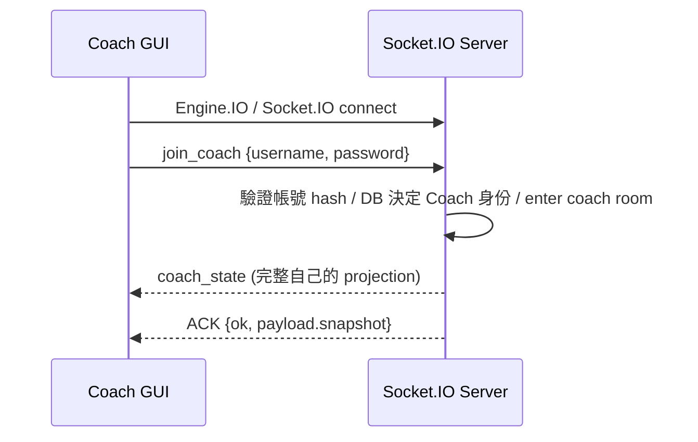
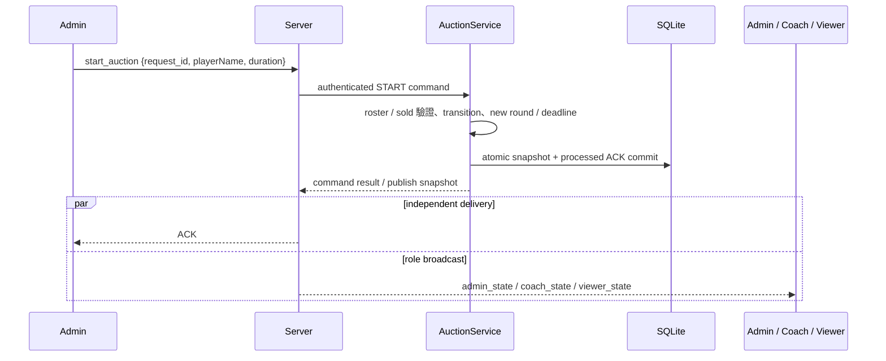
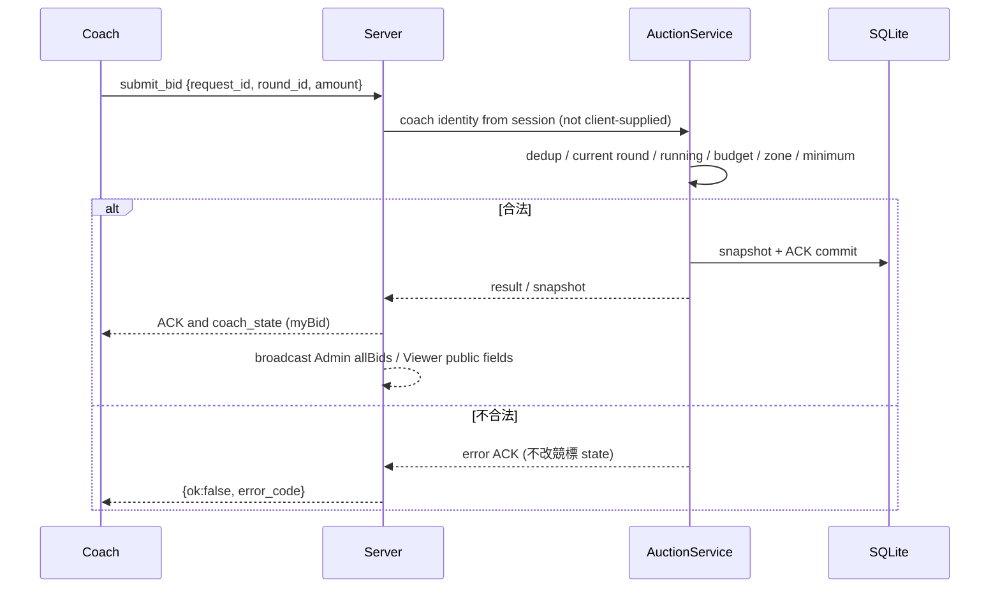
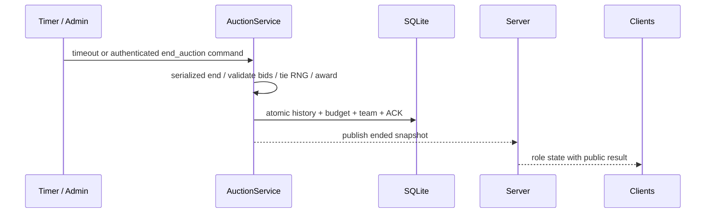
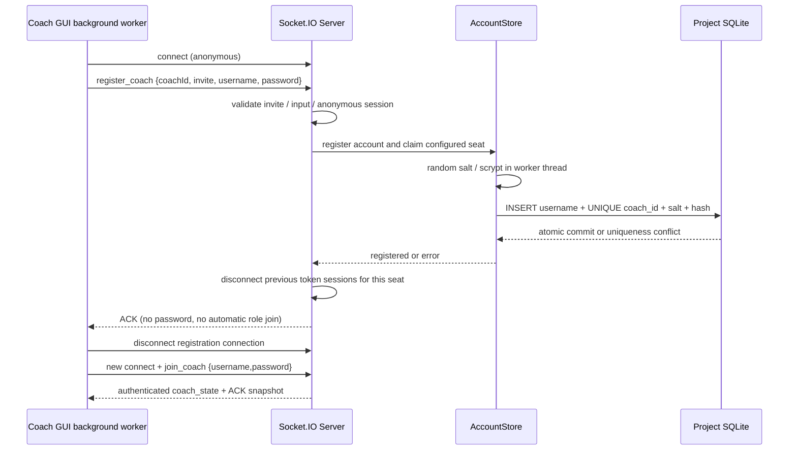

# Client / Server 訊息循序

join ACK 的 `payload.snapshot` 與角色 state event 都提供完整 snapshot；所有 mutation ACK 包含 ok、error_code、version、round_id、request_id、payload。broadcast worker 與 ACK 發送順序不保證，Client 同時處理兩者，不依賴 ACK 先到。

## Coach 登入



## 開始競標



## 出價／修改出價



## 結算



Admin 路徑先經 Transport 驗證 `request_id`／`round_id`，收到 ACK；timer 是 Server 內部命令。Viewer 倒數達 0 不自行推測 winner。

## 斷線／重連

```mermaid
sequenceDiagram
  participant C as Coach
  participant T as Server
  C-xT: disconnect / network loss
  T->>T: transport close or heartbeat timeout; clear SID session
  C->>C: GUI offline; retain last snapshot; discard uncertain queued actions
  C->>T: reconnect (new SID)
  C->>T: join_coach {username, password}
  T-->>C: latest coach_state and join ACK snapshot
  C->>C: version guard; restore myBid / remaining / team / budget
```

Viewer 以 `join_viewer {}` 重連；Admin 用 `join_admin {token}`。正常登出不一定自動重連；非預期中斷 worker 自動重試。Server 不暫停競標等待掉線者。

## Coach 席位註冊



未認領席位可相容舊 token 登入；認領後失效。錯誤或 ACK 遺失的處理見 [註冊文件](FINAL_PROJECT_REGISTRATION.md)。
